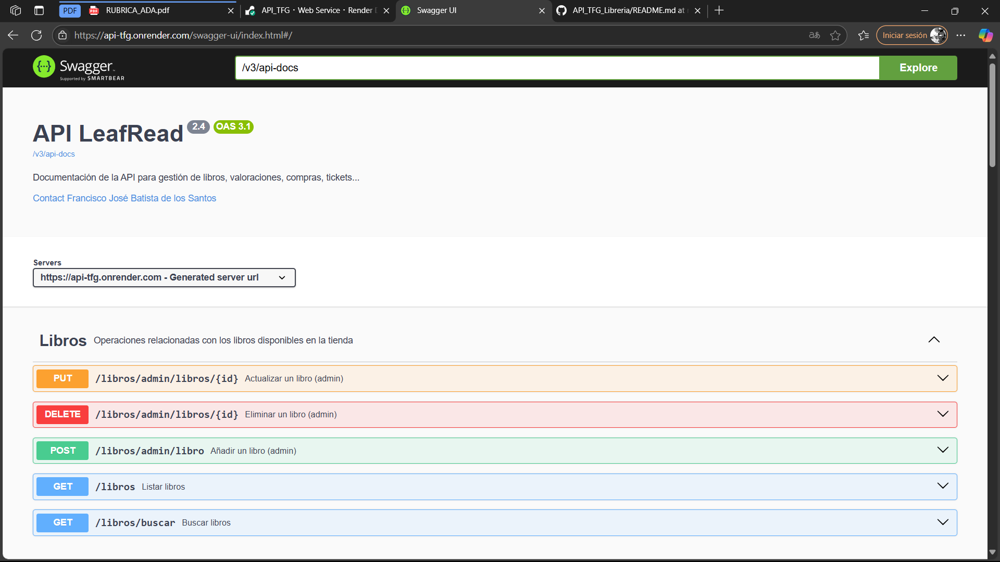
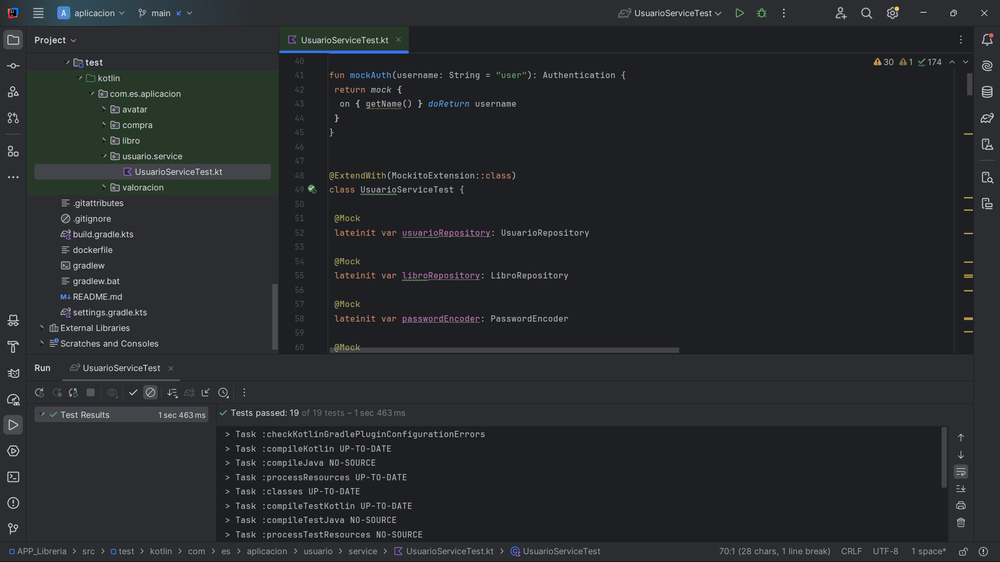
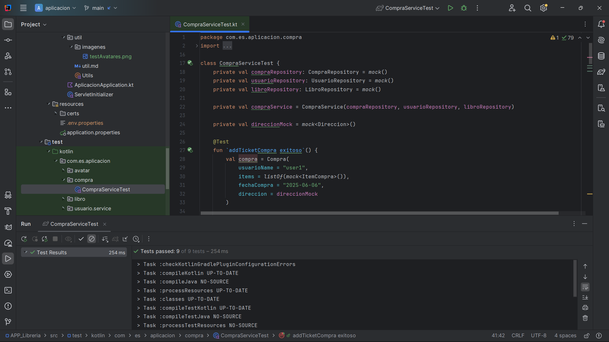

# LeafRead API

API REST de una librería online, hecha con **Kotlin y Spring Boot**. Gestiona usuarios, catálogo, carrito, compras con pago por Stripe, valoraciones y tickets de soporte. Es el backend de la app [KotlinLibreriaKMP](https://github.com/fbatlos/KotlinLibreriaKMP) (Android y escritorio).

Proyecto final de ciclo (TFG) de Francisco José Batista de los Santos.



**Documentación interactiva:** [Swagger UI en Render](https://api-tfg.onrender.com/swagger-ui/index.html#/). El servicio está en un plan gratuito, así que la primera petición puede tardar en despertar.

## Qué hace

- **Usuarios:** registro y login con JWT, direcciones, favoritos, cesta y avatar. Roles `USER` y `ADMIN`.
- **Libros:** listado público con filtros, búsqueda por texto y CRUD solo para administradores. Control de stock.
- **Compras:** sesión de pago con Stripe, comprobación del estado, tickets de compra y descuento automático de stock.
- **Valoraciones:** puntuación con comentario. Solo puede valorar quien compró el libro, y una vez por libro.
- **Soporte:** tickets de duda entre usuario y administrador.

## Stack

| Capa | Tecnología |
|---|---|
| Lenguaje | Kotlin 1.9, Java 17 |
| Framework | Spring Boot 3.4 |
| Base de datos | MongoDB |
| Seguridad | Spring Security, OAuth2 Resource Server, JWT firmado con RSA |
| Pagos | Stripe |
| Documentación | springdoc OpenAPI y Swagger UI |
| Pruebas | JUnit 5 y Mockito (55 tests) |
| Despliegue | Docker y Render |

## Arquitectura

Capas clásicas, con una carpeta por responsabilidad en `src/main/kotlin/com/es/aplicacion`:

```
controller   Endpoints REST
service      Reglas de negocio y validaciones
repository   Acceso a MongoDB
model        Documentos (Usuario, Libro, Compra, Valoracion, Ticket...)
dto          Objetos de entrada y salida
security     Configuración de Spring Security y claves RSA
error        Excepciones propias y manejador global de errores
config       OpenAPI y Stripe
```

## Endpoints

| Método | Ruta | Descripción | Acceso |
|---|---|---|---|
| POST | `/usuarios/register` | Registro | Público |
| POST | `/usuarios/login` | Login, devuelve el token JWT | Público |
| GET | `/usuarios/usuario` | Datos del usuario autenticado | Usuario |
| PUT, DELETE | `/usuarios/direccion` | Gestión de direcciones | Usuario |
| GET, POST, DELETE | `/usuarios/favoritos` | Libros favoritos | Usuario |
| GET, POST, PUT, DELETE | `/usuarios/cesta` | Cesta de la compra | Usuario |
| PUT | `/usuarios/avatar` | Cambiar avatar | Usuario |
| GET | `/libros` | Listar libros con filtros | Público |
| GET | `/libros/buscar` | Búsqueda por texto | Usuario |
| POST | `/libros/admin/libro` | Crear libro | Admin |
| PUT, DELETE | `/libros/admin/libros/{id}` | Editar y borrar libro | Admin |
| POST | `/compra/checkout` | Crear sesión de pago | Usuario |
| GET | `/compra/estado/{sessionId}` | Estado del pago | Usuario |
| POST | `/compra/ticket` | Registrar ticket de compra | Usuario |
| GET | `/compra/tickets` | Tickets del usuario | Usuario |
| GET | `/compra/admin/tickets` | Todos los tickets | Admin |
| POST | `/compra/actualizar-stock` | Actualizar stock tras la compra | Usuario |
| GET | `/valoracion/{libro_id}` | Valoraciones de un libro | Público |
| POST | `/valoracion/add` | Valorar un libro comprado | Usuario |
| GET | `/valoracion/mis-valoraciones` | Mis valoraciones | Usuario |
| DELETE | `/valoracion/eliminar/{id}` | Borrar valoración | Usuario |
| GET | `/avatar/allAvatares` | Listar avatares | Usuario |
| GET | `/avatar/miAvatar/{id}` | Obtener avatar | Usuario |
| POST | `/ticket/enviar` | Enviar ticket de duda | Usuario |
| GET | `/ticket/admin/tickets` | Ver tickets de duda | Admin |
| DELETE | `/ticket/admin/ticket/{id}` | Borrar ticket de duda | Admin |

Los errores devuelven un JSON uniforme con los códigos `400`, `401`, `403`, `404` y `409` según el caso.

## Cómo ejecutarlo

Requisitos: JDK 17, una instancia de MongoDB y una clave de prueba de Stripe.

**1. Claves RSA para firmar los JWT.** Desde `src/main/resources/certs`:

```bash
openssl genrsa -out keypair.pem 2048
openssl rsa -in keypair.pem -pubout -out public.pem
openssl pkcs8 -topk8 -inform PEM -outform PEM -nocrypt -in keypair.pem -out private.pem
```

**2. Variables de entorno.** Copia `.env.example` a `src/main/resources/.env.properties` y rellena tus valores. Ese archivo y los `.pem` están en `.gitignore`.

**3. Arranque.**

```bash
./gradlew bootRun
```

La API queda en `http://localhost:8080` y Swagger en `/swagger-ui/index.html`.

**Docker.** Genera el WAR con `./gradlew bootWar` y construye la imagen con el `dockerfile` incluido.

## Pruebas

```bash
./gradlew test
```

55 pruebas unitarias sobre los servicios de usuarios, libros, compras, valoraciones y avatares.




## Mejoras previstas

- Pruebas de integración de los controladores, en especial de las reglas de acceso por rol.
- GitHub Actions para compilar y lanzar los tests en cada PR.
- Medición de cobertura.
- Perfiles de configuración por entorno.
- Paginación en el listado de libros.

## Autor

**Francisco José Batista de los Santos**: desarrollador backend y full-stack junior.
GitHub: [@fbatlos](https://github.com/fbatlos)
